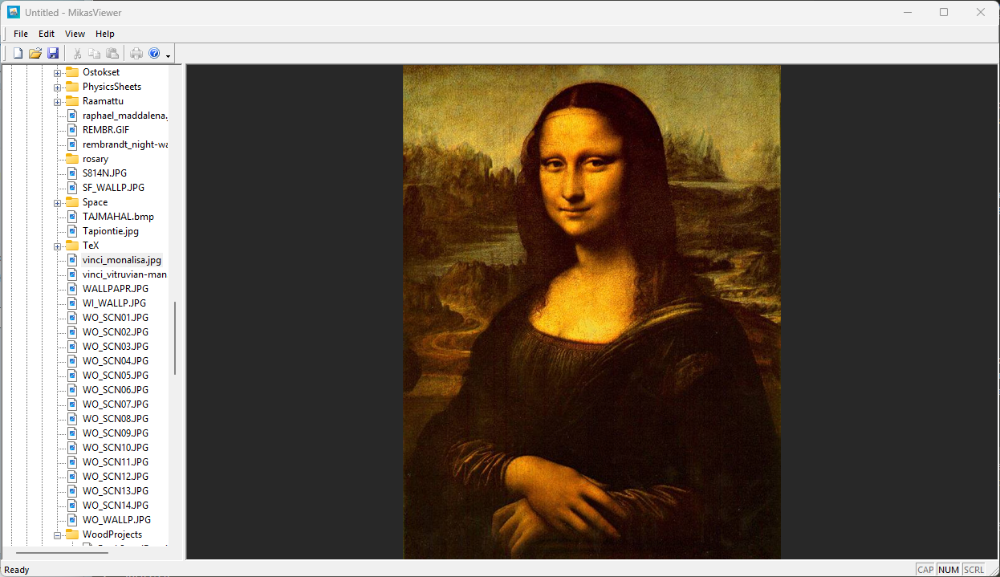

# MikasViewer

MikasViewer is a lightweight Windows image viewer for quick browsing, zooming, and printing of common image formats. It is built with MFC and GDI+ for a familiar desktop experience without the overhead of a full photo-management application.

## Screenshot



## Overview

MikasViewer is designed for users who want an immediate, no-frills workflow:

- Explore drives and folders through an Explorer-style tree,
- Open images directly from the tree without a separate file dialog,
- View and zoom images quickly with smooth GDI+ rendering,
- Pan large images using drag or the scroll bars,
- Print or preview the current image in a single click.

## Audience

This application is intended for:

- Desktop users who browse folders of photographs and illustrations,
- Windows users who prefer a simple native MFC viewer,
- Developers or testers who need a minimal reference app for image viewing and printing.

## Features

- Explorer-style folder tree with logical drives at the root,
- Lazy loading for large directory structures,
- Image files displayed inline with folders,
- Fit-to-window rendering with centered presentation,
- Mouse-wheel zoom anchored to the cursor position,
- Drag-to-pan behavior for large images,
- Double-buffered drawing for a smooth, low-flicker viewer experience,
- Dark viewing background similar to common image viewer apps,
- Window title bar showing the current filename,
- WebP decoding through WIC when GDI+ cannot open the file,
- Print and print-preview support with page scaling,
- Built-in CHM help via F1 or Help > Help Topics.

## Supported Image Formats

| Extension | Format |
|-----------|--------|
| `.jpg` / `.jpeg` | JPEG |
| `.png` | PNG |
| `.bmp` | Bitmap |
| `.gif` | GIF |
| `.tif` / `.tiff` | TIFF |
| `.webp` | WebP (via WIC) |

> WebP support on Windows 10 requires the [WebP Image Extensions](https://apps.microsoft.com/detail/9pg2dk419drg) app from the Microsoft Store. On Windows 11, the codec is built in.

## Requirements

- Windows 10 or later,
- Visual Studio 2022 (v143 toolset) or Visual Studio 2026 Community,
- MFC support from the "Desktop development with C++" workload,
- Optional: HTML Help Workshop for rebuilding the CHM help file,
- Optional: Inno Setup 6 for creating the installer package.

## Build Instructions

1. Open `MikasViewer.slnx` in Visual Studio.
2. Set the configuration to **Debug** or **Release**.
3. Set the platform to **x64**.
4. Choose **Build > Build Solution**.

The build output is placed in `x64\Debug\` or `x64\Release\` depending on the selected configuration.

> Help file rebuild: `"C:\Program Files (x86)\HTML Help Workshop\hhc.exe" help\MikasViewer.hhp`

## Documentation

- Help topics: `help\`
- CHM help file: `help\MikasViewer.chm`
- Main project docs: `README.md`

## Creating the Installer

The installer is created with [Inno Setup 6](https://jrsoftware.org/isinfo.php).

Prerequisites:

1. Build the **Release x64** configuration first.
2. Rebuild the CHM help file so `help\MikasViewer.chm` exists.
3. Install [Inno Setup 6](https://jrsoftware.org/isdl.php) if not already available.

Build command:

```powershell
"C:\Program Files (x86)\Inno Setup 6\ISCC.exe" MikasViewer.iss
```

The resulting package is written to `setup_output\MikasViewerSetup-1.0-x64.exe`.

## Usage

| Action | Result |
|--------|--------|
| Click a folder in the tree | Displays the first image found in that folder |
| Click an image file in the tree | Displays that image |
| Mouse wheel | Zoom in / out, anchored to the cursor |
| Left-click + drag | Pan the image |
| `Ctrl+P` | Print the current image |
| `F1` or Help > Help Topics | Open the built-in help file |

## Troubleshooting

- Help does not open: ensure `MikasViewer.chm` exists next to the executable.
- Images do not display: verify the file is a supported format and that the file extension matches the content.
- WebP files fail to load: install the WebP Image Extensions app on Windows 10.
- Print is unavailable: confirm that an image is currently displayed.
- The application does not start: install the Visual C++ 2015–2022 x64 redistributable if required.

## Contributing

Contributions are welcome. Please:

- Keep changes focused and compatible with Windows MFC conventions,
- Preserve existing public file formats, keyboard mappings, and backward compatibility,
- Validate with a clean build before submitting,
- Update the help documentation when user-visible behavior changes,
- Keep commit messages concise and meaningful.

## License

This project is licensed under the MIT license.
